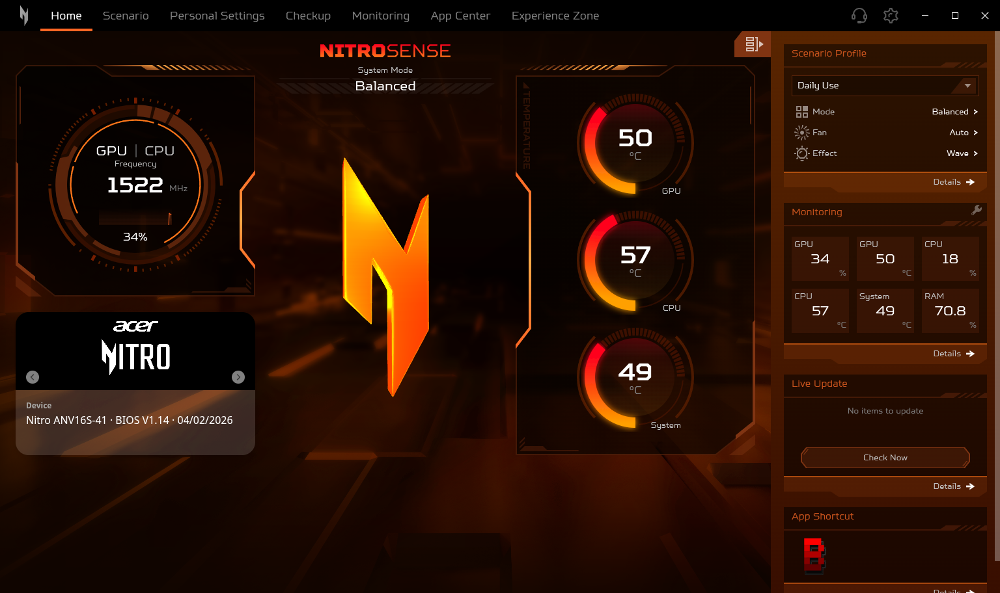
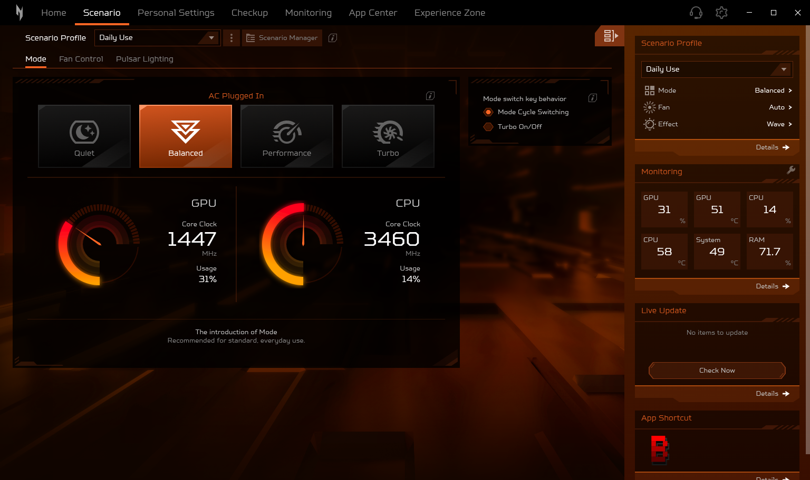
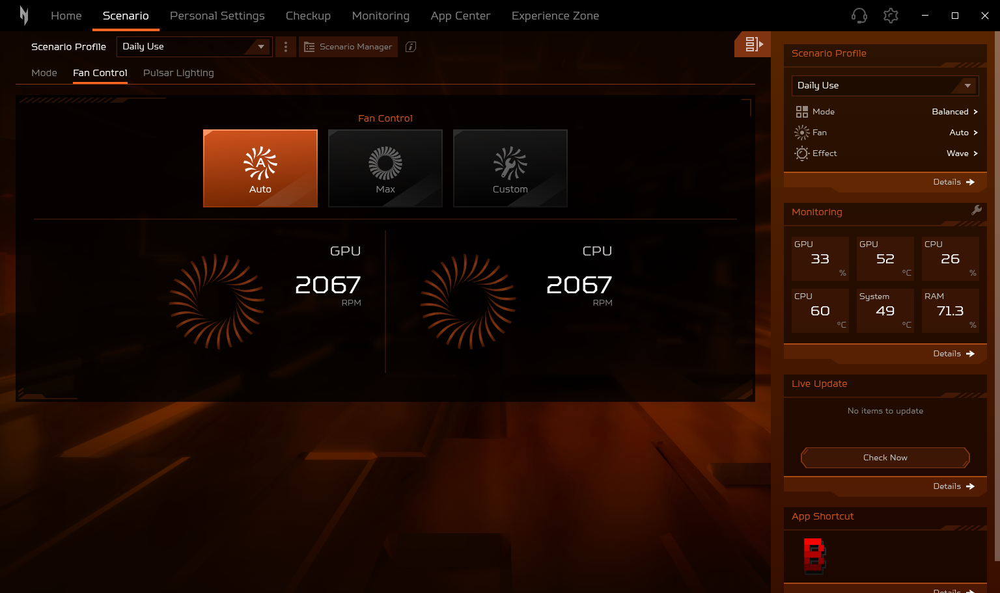
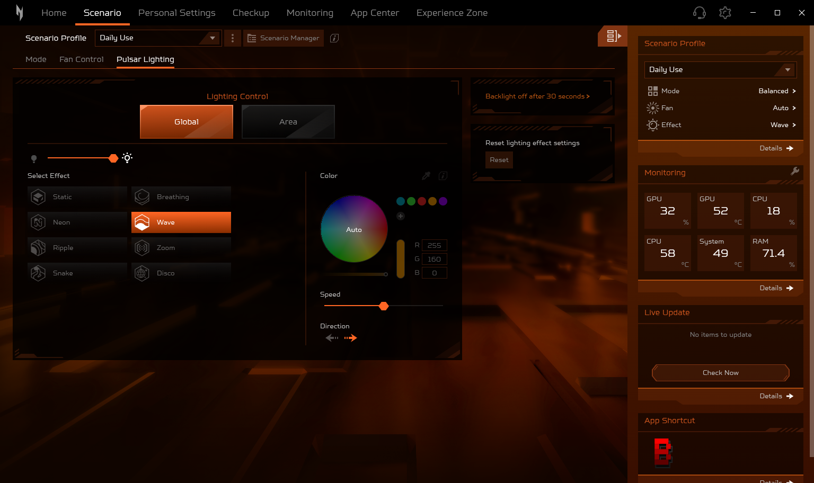
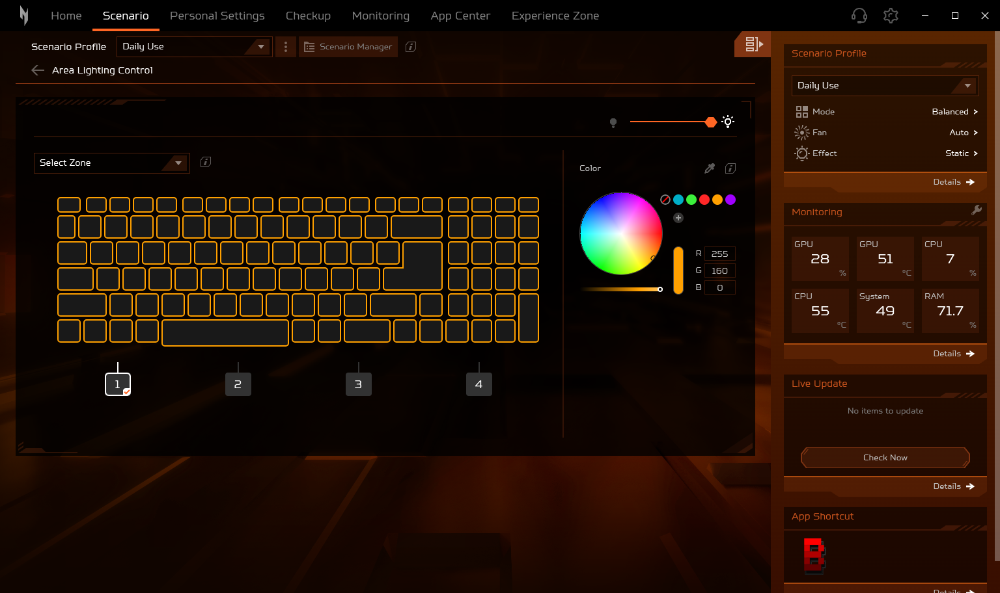
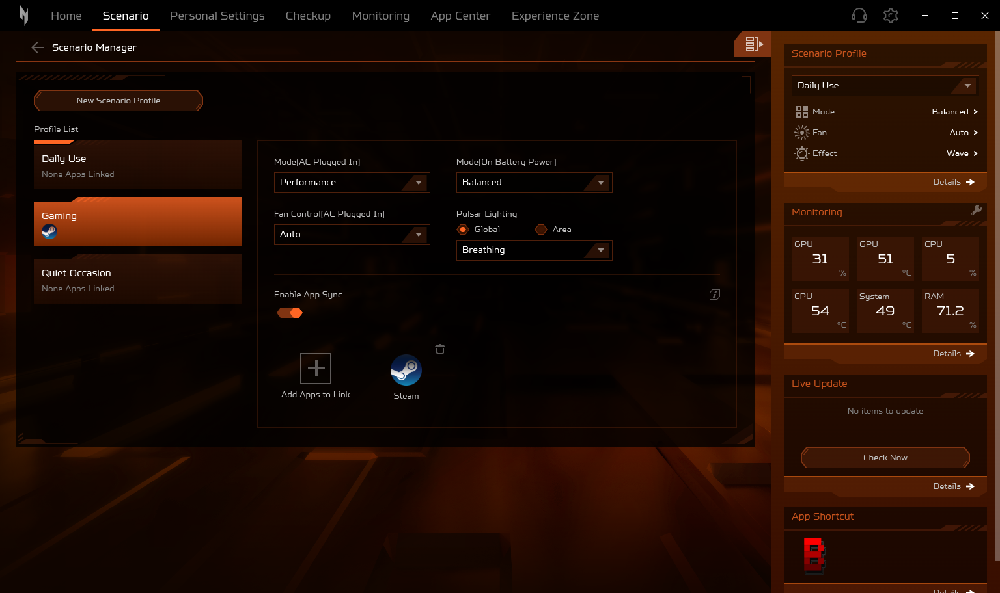
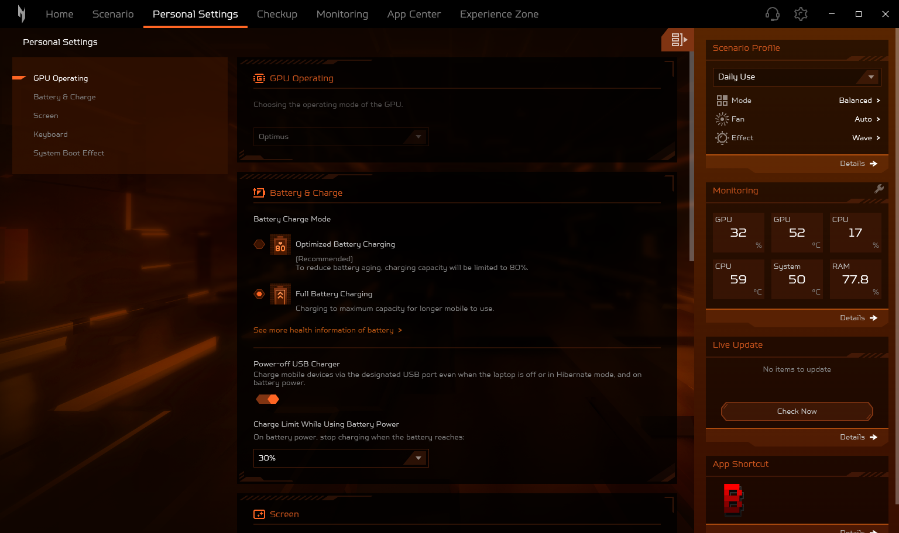
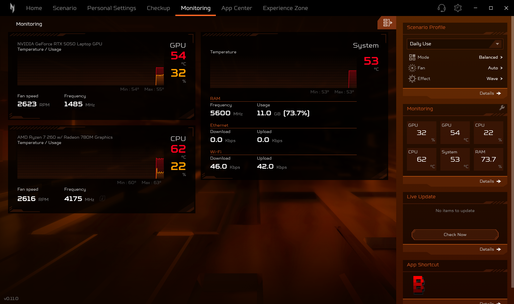

# NitroSense for Linux

Unofficial recreation of Acer's NitroSense control center for Acer Nitro laptops on Linux. It aims to look and
behave like NitroSense on Windows, and talks to the hardware through the [linuwu-sense](https://github.com/0x7375646F/Linuwu-Sense)
kernel driver.

> **Status: early development (v0.15.0).** Not every page is done yet. Tested on an Acer Nitro ANV16S-41 running
> Arch Linux (Omarchy / Hyprland); other models: [Supported laptops](#supported-laptops).



<table>
  <tr>
    <td width="50%"></td>
    <td width="50%"></td>
  </tr>
  <tr>
    <td align="center">Scenario → Mode</td>
    <td align="center">Scenario → Fan Control</td>
  </tr>
  <tr>
    <td></td>
    <td></td>
  </tr>
  <tr>
    <td align="center">Scenario → Pulsar Lighting</td>
    <td align="center">Area Lighting Control (keyboard zones)</td>
  </tr>
  <tr>
    <td></td>
    <td></td>
  </tr>
  <tr>
    <td align="center">Scenario Manager with App Sync</td>
    <td align="center">Personal Settings</td>
  </tr>
  <tr>
    <td colspan="2"></td>
  </tr>
  <tr>
    <td colspan="2" align="center">Monitoring</td>
  </tr>
</table>

Screenshots: the Linux app on a Nitro ANV16S-41 (Hyprland), showing live sensor readings.

## Features

| Area | What works |
|---|---|
| Home | Live CPU / GPU / system temperature gauges, GPU / CPU frequency and usage, 3D mode avatar, device / battery / driver card |
| Side panel | Scenario profiles, monitoring tiles (configurable), update check against GitHub releases, app shortcuts |
| Scenario → Mode | Quiet / Balanced / Performance / Turbo (Eco / Balanced on battery), GPU / CPU clock gauges, mode switch key behavior; the laptop's [Mode Switch Key](#mode-switch-key) switches modes |
| Scenario → Fan Control | Auto / Max / Custom with per-fan speed and Auto toggle |
| Scenario → Pulsar Lighting | Keyboard RGB: Global effects (Static, Breathing, Neon, Wave, Ripple, Zoom, Snake, Disco) with brightness, speed, direction and a color wheel; Area mode with a color per keyboard zone; the keyboard flashes the mode color when the power mode changes |
| Scenario profiles | Add, rename, duplicate, restore and remove profiles; applying one sets power mode, fans and lighting |
| Scenario Manager | Every profile in one list: edit its AC and battery mode (the matching one runs when you plug in or unplug), fans and lighting without applying it, plus **App Sync** — link apps to a profile and it is applied while that app is in front |
| Personal Settings | GPU Operating (Optimus / NVIDIA GPU only, applied by restarting), battery charge mode (Optimized = 80 % limit), power-off USB charging with its 10 / 20 / 30 % limit, LCD overdrive, keyboard backlight off after 30 seconds, boot animation & sound |
| Monitoring | GPU, CPU and system temperature charts (GPU and CPU with usage), with min / max and a readout under the pointer; fan speeds, clocks, RAM speed and usage, Ethernet and Wi-Fi download / upload rates; CPU Details, a btop-style view of every logical CPU (mini 2-minute usage chart, usage and clock) under a 2-minute temperature / usage chart with total usage, average clock, temperature and load average (our own design: NitroSense's dialog only lists the clocks) |

Bluelight Shield™, Sticky keys and Boot Logo Customization are shown greyed out: they don't work on Linux yet.
The Checkup, App Center and Experience Zone tabs, the Support and Settings buttons, and the App Shortcut and Live
Update widgets' Details are greyed out too, until their pages are built.

### GPU Operating

On laptops with a MUX switch, GPU Operating switches between Optimus and NVIDIA GPU only, and like NitroSense it
restarts the computer to apply the change. It needs linuwu-sense's `gpu_mode` file, which is waiting to be
merged upstream ([linuwu-sense #154](https://github.com/0x7375646F/Linuwu-Sense/pull/154)). Until then the installer
builds linuwu-sense from [our fork](https://github.com/abduvaliy-engineer/Linuwu-Sense/tree/gpu-mode-pinned), which
is upstream plus only that patch. With a linuwu-sense you installed yourself, the card shows the current mode greyed out.

In NVIDIA GPU only mode the laptop panel gets a new connector name (`eDP-2` instead of `eDP-1`), so a `preferred`
monitor rule falls back to 60 Hz. On Hyprland, ask for the highest refresh rate instead: `monitor = , highrr, auto, 1`
(or `mode = "highrr"` in a Lua config).

### Keyboard lighting

Two kinds of keyboards are supported, picked automatically:

- **ENEK5130 HID keyboards** (e.g. Nitro ANV16S-41): written through `/dev/hidraw*` with the same reports Acer's
  Windows lighting service sends. Needs `python3`, because Node.js cannot issue the HID ioctl itself.
- **linuwu-sense `four_zoned_kb`** (e.g. Nitro AN515-58, AN16-41, Predator PHN16-71): written through the driver's
  `four_zone_mode` and `per_zone_mode` files.

The eyedropper uses `hyprpicker` when it is installed. DAMX also drives the keyboard, so use one app at a time for
lighting.

### App Sync

Like NitroSense, App Sync applies a profile while one of its linked apps is in front and returns to the profile you
picked when you switch to anything else (NitroSense's own window included), after the change has held for 3 seconds.
Hyprland reports which window is in front; on other desktops the most recently started linked app that is running
counts. Apps come from your desktop entries and Steam library, or any executable, AppImage or Windows `.exe` you pick.

NitroSense keeps running in the background when you close its window, so App Sync and the mode-change keyboard flash
keep working, and the installer starts it hidden at login. Open it again from the launcher or with the NitroSense key;
quit it with `nitrosense --quit`.

## Supported laptops

NitroSense for Linux drives the hardware through [linuwu-sense](https://github.com/0x7375646F/Linuwu-Sense), the driver
[DAMX](https://github.com/PXDiv/Div-Acer-Manager-Max) uses too, so it supports the Acer Nitro and Predator laptops they
support. It's tested on a Nitro V 16S ANV16S-41. Other models may miss some controls: please
[open an issue](https://github.com/abduvaliy-engineer/Nitro-Sense/issues) and tell how it works on yours.

| Series | Supported by the driver the app installs | Supported by a newer linuwu-sense or by DAMX |
|---|---|---|
| Nitro V 15 / V 16 | ANV15-41, ANV15-51, ANV16-41, ANV16S-41 (tested) | ANV15-52, ANV16-71 |
| Nitro 16 / 17 | AN16-41, AN16-42, AN16-43 | AN17-51 |
| Nitro 5 | AN515-55, AN515-58 | AN515-44, AN515-45, AN515-47, AN515-54, AN515-57, AN517-41, AN517-54 |
| Predator Helios Neo | PHN16-71, PHN16-72 | PHN14-51, PHN16-73, PHN16S-71 |
| Predator Helios | PH16-71, PH18-71 | PH16-72, PH18-73, PH315-52, PH315-53, PH315-54 |
| Predator Triton | PTX17-71 | |
| Other Predator | | PHIN16-71, PHIN16S-71 |

The driver the installer and the packages install doesn't know the models in the last column yet. On those,
`options linuwu_sense nitro_v4=1` (Nitro) or `options linuwu_sense predator_v4=1` (Predator) in
`/etc/modprobe.d/linuwu_sense.conf` may turn on fans and modes, as DAMX's Internals Manager does; the installer and the
packages keep that file.

## Install

### Debian, Ubuntu and Fedora (.deb, .rpm)

Download the two packages for your distribution from the
[latest release](https://github.com/abduvaliy-engineer/Nitro-Sense/releases/latest), then:

```sh
# Debian 13, Ubuntu 24.04 and 26.04
sudo apt install ./nitrosense-linux_*_amd64.deb ./linuwu-sense-gpu-mode-dkms_*_all.deb
# Fedora 44 and 45
sudo dnf install ./nitrosense-linux-*.x86_64.rpm ./linuwu-sense-gpu-mode-dkms-*.noarch.rpm

nitrosense-setup        # once per user, then log out and back in
```

- `nitrosense-linux` installs the app to `/usr/lib/nitrosense-linux` with its own Electron (43.8.6), a `nitrosense`
  command, a desktop entry, a login autostart, and the udev rule that lets the `linuwu_sense` group use the controls.
  On Ubuntu 24.04 and newer it adds an AppArmor profile that lets only its Electron create the user namespaces its
  sandbox needs.
- Installing it takes [NitroSense's artwork](#nitrosense-artwork) from NitroSense on a mounted Windows drive,
  otherwise from Acer's package in the Microsoft Store (about 340 MB), into `/var/lib/nitrosense-linux`. Offline, the
  install still finishes, and `sudo nitrosense-artwork` gets the artwork later;
  `sudo nitrosense-artwork <app.asar, WindowsApps folder or .msixbundle>` takes it from a NitroSense you have.
- `linuwu-sense-gpu-mode-dkms` is the linuwu-sense driver with `gpu_mode`, the one the installer builds. DKMS builds
  it for every kernel with headers (Debian/Ubuntu: `linux-headers-$(uname -r)`, Fedora: `kernel-devel`) and again
  after kernel updates; it loads after a restart. The driver needs Linux 6.14 or newer: on Ubuntu 24.04 that's its
  HWE kernel (`sudo apt install linux-generic-hwe-24.04`), on Debian 13 the kernel from trixie-backports. The app
  only recommends the driver: with DAMX's linuwu-sense everything works except GPU Operating.
- `nitrosense-setup` does what a package can't: it adds you to the `linuwu_sense` group and binds the
  [NitroSense key](#nitrosense-key).
- The `nitrosense-modekey` service makes the [Mode Switch Key](#mode-switch-key) switch modes; udev starts it.
- Live Update's **Update All** downloads the new packages from the release, checks them against its `SHA256SUMS` and
  installs them with apt or dnf (one password prompt).
- Removing: `nitrosense-setup --remove` for the key binding, then
  `sudo apt purge nitrosense-linux linuwu-sense-gpu-mode-dkms` or `sudo dnf remove nitrosense-linux linuwu-sense-gpu-mode-dkms`.
- Moving from the installer: the driver package stops while the installer's driver is there. Run
  `./install.sh --uninstall`, then `sudo dkms remove linuwu-sense/1.0.0 --all && sudo rm -rf /usr/src/linuwu-sense-1.0.0`.
- On every change, the Checks workflow installs, reinstalls and removes both packages on Ubuntu 24.04 and 26.04,
  Debian 13 and Fedora 44 and 45.

### Arch Linux (AUR)

```sh
yay -S nitrosense-linux linuwu-sense-gpu-mode-dkms
nitrosense-setup        # once per user, then log out and back in
```

Not on the AUR yet: AUR registration is paused, so the account that publishes them doesn't exist. Until then,
`makepkg -si` in `packaging/aur/linuwu-sense-gpu-mode-dkms`, then in `packaging/aur/nitrosense-linux`, builds and
installs the same packages from this repository.

- [`nitrosense-linux`](https://aur.archlinux.org/packages/nitrosense-linux) installs the app to
  `/usr/lib/nitrosense-linux`, with a `nitrosense` command, a desktop entry, a login autostart, and the udev rule
  that lets the `linuwu_sense` group use the controls.
- It needs a linuwu-sense driver (`linuwu-sense-dkms`). [`linuwu-sense-gpu-mode-dkms`](https://aur.archlinux.org/packages/linuwu-sense-gpu-mode-dkms)
  is the one the installer below builds, with `gpu_mode` for GPU Operating. Other linuwu-sense packages, DAMX's
  included, work too, with GPU Operating greyed out.
- Building it fetches NitroSense's artwork from Acer's package in the Microsoft Store (about 340 MB), like the
  installer, and checks every file. To use a NitroSense you already have, build with
  `NITROSENSE_ASSETS=<app.asar, WindowsApps folder or .msixbundle>`.
- `nitrosense-setup` does what a package can't: it adds you to the `linuwu_sense` group and binds the
  [NitroSense key](#nitrosense-key). Before uninstalling, `nitrosense-setup --remove` removes the key binding.
- The `nitrosense-modekey` service makes the [Mode Switch Key](#mode-switch-key) switch modes; udev starts it.
- Updates come with your AUR helper (`yay -Syu`); Live Update only tells you about them.
- Moving from the installer: run `./install.sh --uninstall`, then remove its driver with
  `sudo dkms remove linuwu-sense/1.0.0 --all && sudo rm -rf /usr/src/linuwu-sense-1.0.0`.

### Installer (Arch, Debian/Ubuntu, Fedora)

```sh
git clone https://github.com/abduvaliy-engineer/Nitro-Sense.git
cd Nitro-Sense
./install.sh
```

Run it as your normal user; it asks for `sudo` when it needs root. On Ubuntu 24.04 and newer use the .deb instead:
the installer stops there, because Ubuntu blocks the sandbox of an Electron in your home folder. It:

1. Installs the packages: Electron (`electron43` on Arch, otherwise Electron's own build, checked against its
   checksum), python3, and DKMS with kernel headers when the driver has to be built. Arch, Debian/Ubuntu and Fedora
   are supported.
2. Builds the [linuwu-sense](https://github.com/0x7375646F/Linuwu-Sense) driver with DKMS if it is not
   installed yet, so it is rebuilt on kernel updates, and replaces `acer_wmi` with it. A driver the installer built
   before is updated when the version it builds changes (the new one loads after a restart); a linuwu-sense you
   installed another way is left alone.
3. Adds you to the `linuwu_sense` group and installs `data/70-nitrosense.rules`, so the app can use the
   driver's controls and the keyboard lighting without root, and the [Mode Switch Key](#mode-switch-key) service.
4. Installs the app to `~/.local/share/nitrosense`, with a `nitrosense` launcher and a desktop entry, and binds
   the NitroSense key on Hyprland and GNOME (see below).
5. Adds NitroSense's artwork (see below).

Log out and back in afterwards if the installer added you to the group. Other options: `--assets PATH`,
`--dev` (run from the checkout with live reload), `--no-driver` and `--uninstall`.

### NitroSense artwork

The icons, fonts, backgrounds and 3D models belong to Acer, so they are not in this repository or the packages. The
installer copies them from Acer's own NitroSense package and checks every file against `data/acer-assets.tsv` (the
.deb and .rpm do the same when they're installed, with `nitrosense-artwork`, and the AUR package when it's built):

- from NitroSense installed on Windows (the newest artwork): during its password prompt the installer mounts
  Windows drives read-only for a moment, or uses one that is already mounted, or
- by downloading NitroSense (about 340 MB) from the Microsoft Store's servers. No Windows install or Microsoft
  account is needed, and the download is deleted afterwards. The Store build is NitroSense 5.0, so the Home
  gauge frame and the Disco lighting icon look like NitroSense 5.0's.
- `./install.sh --assets PATH` takes a NitroSense `app.asar`, WindowsApps folder or `.msix`/`.msixbundle` instead.

### NitroSense key

The installer and `nitrosense-setup` (packages) bind the NitroSense key (`XF86Presentation`) to `nitrosense`:

- **Hyprland**: a line in `~/.config/hypr/bindings.lua` or `hyprland.conf`.
- **GNOME**: a custom shortcut named NitroSense (Settings → Keyboard → Custom Shortcuts). If the key already has a
  shortcut, the installer leaves it alone and says so.
- **KDE Plasma** can't bind this key: Qt has no name for `XF86Presentation`, so Plasma's shortcut settings never
  see it. Start NitroSense from the launcher or give it another shortcut.
- **Other Wayland desktops**: bind `XF86Presentation` to `nitrosense` yourself, e.g. on Sway
  `bindsym XF86Presentation exec nitrosense`.
- **X11 sessions** never receive the key: its keycode (433) is above X11's limit of 255.

`./install.sh --uninstall` and `nitrosense-setup --remove` remove only the bindings they added.

### Mode Switch Key

On the ANV16S-41 the Mode Switch Key never reaches Linux as a key: its keyboard (`1025:174B`) sends it as a vendor
HID report that Linux drops, and on Windows Acer's service reads that report. The installer and the packages add the
same kind of service, `nitrosense-modekey`. udev starts it for that keyboard, and each press switches to the next
mode, in NitroSense's order:

- **AC plugged in**: Quiet → Balanced → Performance → Turbo → Quiet
- **On battery**: Balanced ↔ Eco
- **AC below 40 % battery** (NitroSense's low-battery lock): Quiet ↔ Balanced

It sets the mode the way the app does, so the keyboard flashes the mode color and the Mode page follows, and it
works with the app closed. It runs as root because only root can read the keyboard's raw reports; it acts on the
key's report and drops every other one. `systemctl status 'nitrosense-modekey@*'` shows it. Other Nitro keyboards
that send the key this way get added as people report them; on models where the key arrives through WMI,
linuwu-sense handles it itself.

## Running

Start NitroSense from your app launcher, with the NitroSense key, or by running `nitrosense`. It is
single-instance: starting it again focuses the open window.

For development, run it from the checkout: `cd app && electron43 . --dev` reloads the window when files change.

## Updates and releases

Live Update in the side panel checks this repository's GitHub releases. **Update All** downloads the new release,
runs `install.sh --update` and restarts NitroSense; it only asks for a password when the driver or permissions
changed. A development checkout (`./install.sh --dev`) is not overwritten; it opens the release page instead. A
.deb or .rpm install updates itself with the release's packages through apt or dnf. The AUR package belongs to
pacman, so there Live Update only shows new versions, and **Update All** is greyed out.

Development happens on the `dev` branch. Merging `dev` into `main` is a release: the Release workflow publishes
the version in `app/package.json` as a GitHub release with its .deb and .rpm packages and `SHA256SUMS`, then
`packaging/aur` to the AUR (only from `main`). The Checks workflow builds every package on each PR, installs the .deb
and .rpm on the distributions above, and refuses a release PR whose version was already released. Versions stay `0.x` (0.9, 0.10, 0.11, ...) until the app matches NitroSense one to one;
that release will be 1.0.0.

## Project layout

```
app/
  main.js, preload.js     Electron main process and the renderer bridge
  backend/                sensors, controls (sysfs writes), lighting, settings, updates, shortcuts
  renderer/               UI: pages/, side panel, shared components
  vendor/                 three.js r125 and lottie-web (MIT, licenses included)
data/                     udev rule, desktop entry, nitrosense-setup, nitrosense-artwork, artwork manifest,
                          the Mode Switch Key service (nitrosense-modekey) and its unit
packaging/aur/            the AUR packages (nitrosense-linux, linuwu-sense-gpu-mode-dkms)
packaging/deb-rpm/        the same two as .deb and .rpm: nfpm configs, install scripts, build.sh
tools/                    artwork extraction and Microsoft Store download
tests/                    lighting encoder, App Sync matching, key binding, driver rebuild, Live Update's package
                          choice, the Mode Switch Key service, and the .deb/.rpm install test
docs/screenshots/         README screenshots
.github/workflows/        checks on every PR, release on merge into main
install.sh                installer
nitrosense/               first GTK prototype (superseded)
```

## License

NitroSense for Linux is free software under the [GNU General Public License v3.0 or later](LICENSE). `app/vendor`
holds three.js and lottie-web under the MIT license, with their license files; the .deb and .rpm also bring Electron
(MIT, with Chromium's licenses). NitroSense's artwork belongs to Acer: it isn't in this repository or the packages,
which take it from Acer's own NitroSense package.

## Disclaimer

Not affiliated with or endorsed by Acer. NitroSense, Nitro and Predator are trademarks of Acer Inc.
Changing fan speeds and power modes is at your own risk.
