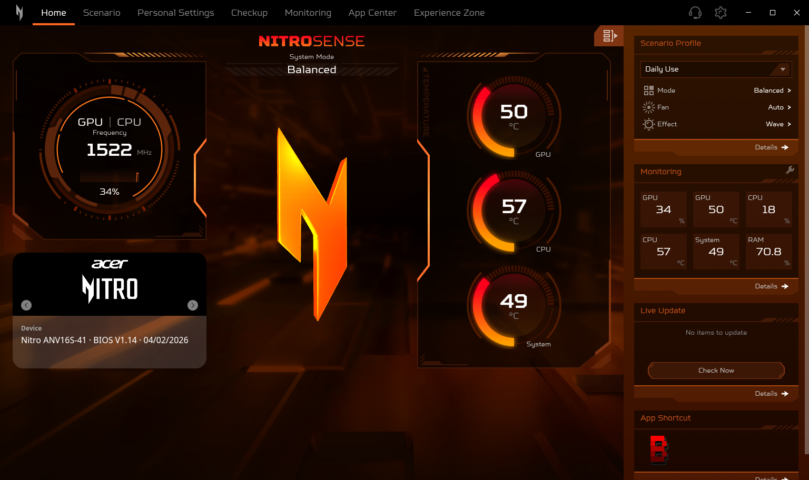
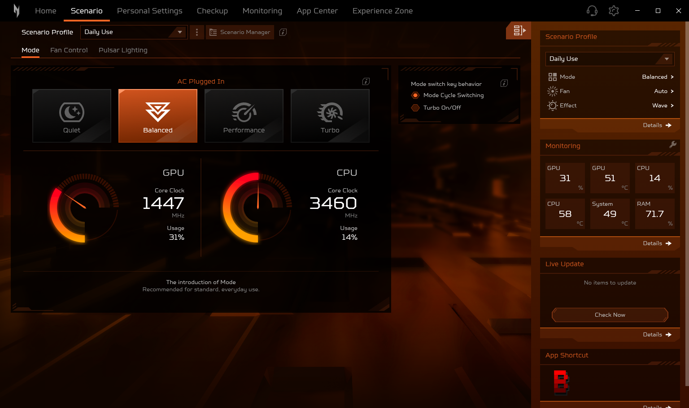
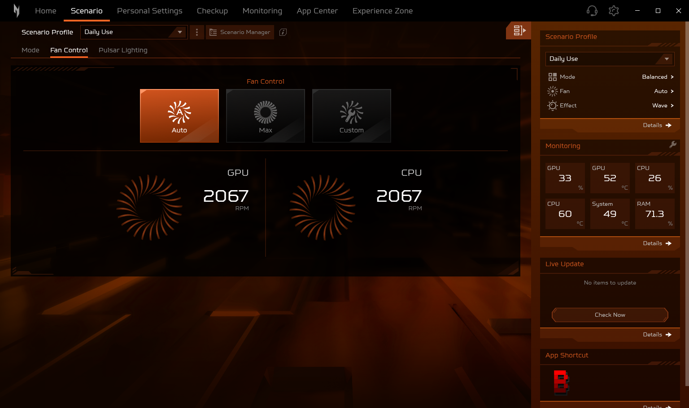
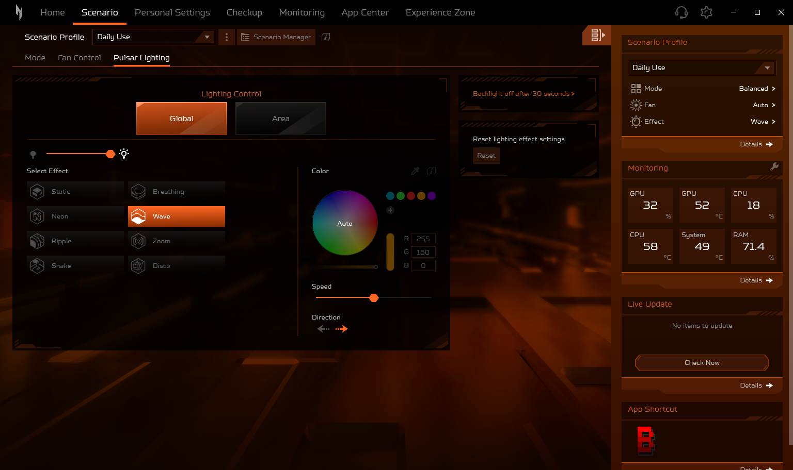
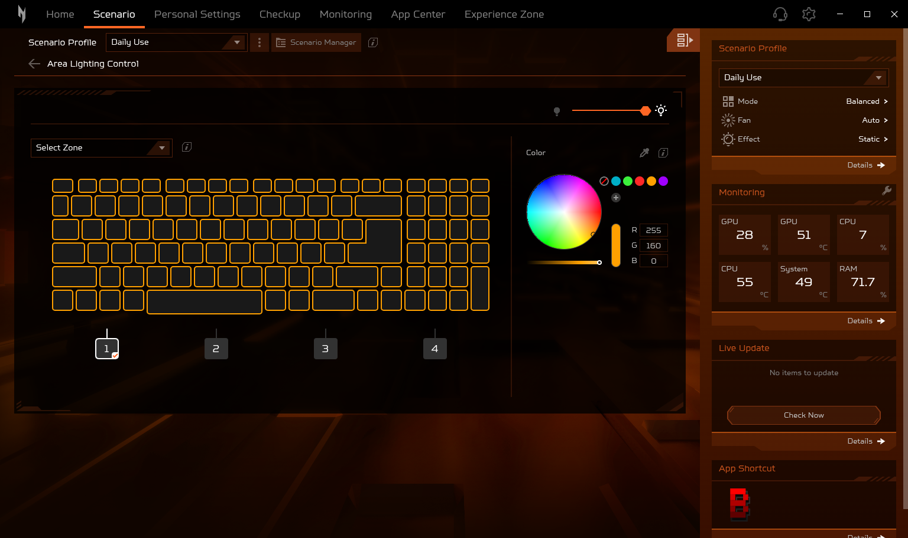
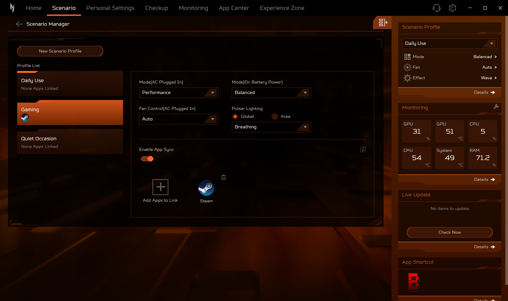
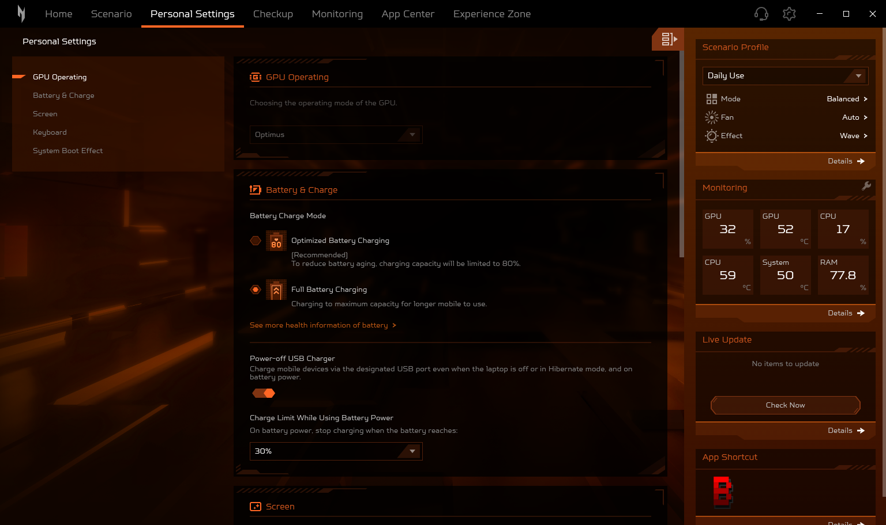
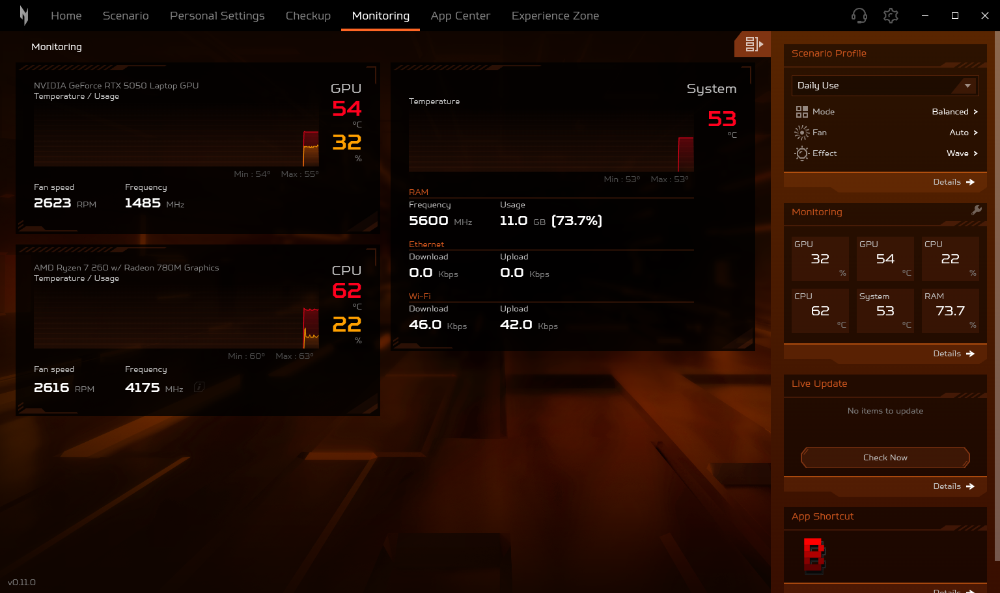

# NitroSense for Linux

Unofficial recreation of Acer's NitroSense control center for Acer Nitro laptops on Linux. It aims to look and
behave like NitroSense on Windows, and talks to the hardware through the [linuwu-sense](https://github.com/0x7375646F/Linuwu-Sense)
kernel driver.

> **Status: early development (v0.11.5).** Not every page is done yet. Tested on an Acer Nitro ANV16S-41 running
> Arch Linux (Omarchy / Hyprland).



<table>
  <tr>
    <td width="50%"></td>
    <td width="50%"></td>
  </tr>
  <tr>
    <td align="center">Scenario → Mode</td>
    <td align="center">Scenario → Fan Control</td>
  </tr>
  <tr>
    <td></td>
    <td></td>
  </tr>
  <tr>
    <td align="center">Scenario → Pulsar Lighting</td>
    <td align="center">Area Lighting Control (keyboard zones)</td>
  </tr>
  <tr>
    <td></td>
    <td></td>
  </tr>
  <tr>
    <td align="center">Scenario Manager with App Sync</td>
    <td align="center">Personal Settings</td>
  </tr>
  <tr>
    <td colspan="2"></td>
  </tr>
  <tr>
    <td colspan="2" align="center">Monitoring</td>
  </tr>
</table>

Screenshots: the Linux app on a Nitro ANV16S-41 (Hyprland), showing live sensor readings.

## Features

| Area | What works |
|---|---|
| Home | Live CPU / GPU / system temperature gauges, GPU / CPU frequency and usage, 3D mode avatar, device / battery / driver card |
| Side panel | Scenario profiles, monitoring tiles (configurable), update check against GitHub releases, app shortcuts |
| Scenario → Mode | Quiet / Balanced / Performance / Turbo (Eco / Balanced on battery), GPU / CPU clock gauges, mode switch key behavior |
| Scenario → Fan Control | Auto / Max / Custom with per-fan speed and Auto toggle |
| Scenario → Pulsar Lighting | Keyboard RGB: Global effects (Static, Breathing, Neon, Wave, Ripple, Zoom, Snake, Disco) with brightness, speed, direction and a color wheel; Area mode with a color per keyboard zone; the keyboard flashes the mode color when the power mode changes |
| Scenario profiles | Add, rename, duplicate, restore and remove profiles; applying one sets power mode, fans and lighting |
| Scenario Manager | Every profile in one list: edit its AC and battery mode, fans and lighting without applying it, plus **App Sync** — link apps to a profile and it is applied while that app is in front |
| Personal Settings | Battery charge mode (Optimized = 80 % limit), power-off USB charging with its 10 / 20 / 30 % limit, LCD overdrive, keyboard backlight off after 30 seconds, boot animation & sound |
| Monitoring | GPU, CPU and system temperature charts (GPU and CPU with usage), with min / max and a readout under the pointer; fan speeds, clocks, RAM speed and usage, Ethernet and Wi-Fi download / upload rates; CPU Details, a btop-style view of every logical CPU (mini 2-minute usage chart, usage and clock) under a 2-minute temperature / usage chart with total usage, average clock, temperature and load average (our own design: NitroSense's dialog only lists the clocks) |

GPU Operating, Bluelight Shield™, Sticky keys and Boot Logo Customization are shown greyed out: they don't work on
Linux yet. Checkup, App Center and Experience Zone are not built yet.

### Keyboard lighting

Two kinds of keyboards are supported, picked automatically:

- **ENEK5130 HID keyboards** (e.g. Nitro ANV16S-41): written through `/dev/hidraw*` with the same reports Acer's
  Windows lighting service sends. Needs `python3`, because Node.js cannot issue the HID ioctl itself.
- **linuwu-sense `four_zoned_kb`** (e.g. Nitro AN515-58, AN16-41, Predator PHN16-71): written through the driver's
  `four_zone_mode` and `per_zone_mode` files.

The eyedropper uses `hyprpicker` when it is installed. DAMX also drives the keyboard, so use one app at a time for
lighting.

### App Sync

Like NitroSense, App Sync applies a profile while one of its linked apps is in front and returns to the profile you
picked when you switch to anything else (NitroSense's own window included), after the change has held for 3 seconds.
Hyprland reports which window is in front; on other desktops the most recently started linked app that is running
counts. Apps come from your desktop entries and Steam library, or any executable, AppImage or Windows `.exe` you pick.

NitroSense keeps running in the background when you close its window, so App Sync and the mode-change keyboard flash
keep working, and the installer starts it hidden at login. Open it again from the launcher or with the NitroSense key;
quit it with `nitrosense --quit`.

## Install

```sh
git clone https://github.com/abduvaliy-engineer/Nitro-Sense.git
cd Nitro-Sense
./install.sh
```

Run it as your normal user; it asks for `sudo` when it needs root. It:

1. Installs the packages: Electron (`electron43` on Arch, otherwise Electron's own build), python3, and DKMS
   with kernel headers when the driver has to be built. Arch, Debian/Ubuntu and Fedora are supported.
2. Builds the [linuwu-sense](https://github.com/0x7375646F/Linuwu-Sense) driver with DKMS if it is not
   installed yet, so it is rebuilt on kernel updates, and replaces `acer_wmi` with it.
3. Adds you to the `linuwu_sense` group and installs `data/70-nitrosense.rules`, so the app can use the
   driver's controls and the keyboard lighting without root.
4. Installs the app to `~/.local/share/nitrosense`, with a `nitrosense` launcher and a desktop entry, and binds
   the NitroSense key in Hyprland.
5. Verifies the bundled NitroSense artwork (see below).

Log out and back in afterwards if the installer added you to the group. Other options: `--assets PATH`,
`--dev` (run from the checkout with live reload), `--no-driver` and `--uninstall`.

### NitroSense artwork

The app includes all 172 required artwork files: icons, fonts, backgrounds, animations and 3D models.
Fresh installs and updates use this bundled artwork without downloading a Microsoft Store package or
searching Windows drives. The installer verifies every file against `data/acer-assets.tsv` before changing
the system; CI and release checks also reject missing or modified artwork.

The artwork belongs to Acer. `./install.sh --assets PATH` optionally imports verified artwork from a local
NitroSense `app.asar`, WindowsApps folder or `.msix`/`.msixbundle`. Maintainers can use the tools in `tools/`
to refresh the bundle, then run `python3 tools/check-acer-assets.py data/acer-assets.tsv app/assets/acer`.
System packages, Electron and the Linux driver may still require internet access during installation.

## Running

Start NitroSense from your app launcher, with the NitroSense key, or by running `nitrosense`. It is
single-instance: starting it again focuses the open window.

For development, run it from the checkout: `cd app && electron43 . --dev` reloads the window when files change.

## Updates and releases

Live Update in the side panel checks this repository's GitHub releases. **Update All** downloads the new release,
runs `install.sh --update` and restarts NitroSense; it only asks for a password when the driver or permissions
changed. A development checkout (`./install.sh --dev`) is not overwritten; it opens the release page instead.

Development happens on the `dev` branch. Merging `dev` into `main` is a release: the Release workflow publishes
the version in `app/package.json` as a GitHub release, and the Checks workflow refuses a release PR whose
version was already released. Versions stay `0.x` (0.9, 0.10, 0.11, ...) until the app matches NitroSense one to one;
that release will be 1.0.0.

## Project layout

```
app/
  main.js, preload.js     Electron main process and the renderer bridge
  backend/                sensors, controls (sysfs writes), lighting, settings, updates, shortcuts
  renderer/               UI: pages/, side panel, shared components
  vendor/                 three.js r125 and lottie-web (MIT, licenses included)
data/                     udev rule, desktop entry, artwork manifest
tools/                    artwork verification, extraction and maintainer download tools
tests/                    artwork verifier, lighting encoder and App Sync matching checks
docs/screenshots/         README screenshots
.github/workflows/        checks on every PR, release on merge into main
install.sh                installer
nitrosense/               first GTK prototype (superseded)
```

## Disclaimer

Not affiliated with or endorsed by Acer. NitroSense, Nitro and Predator are trademarks of Acer Inc.
Changing fan speeds and power modes is at your own risk.
